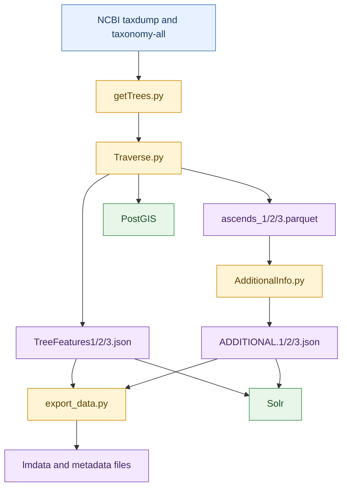
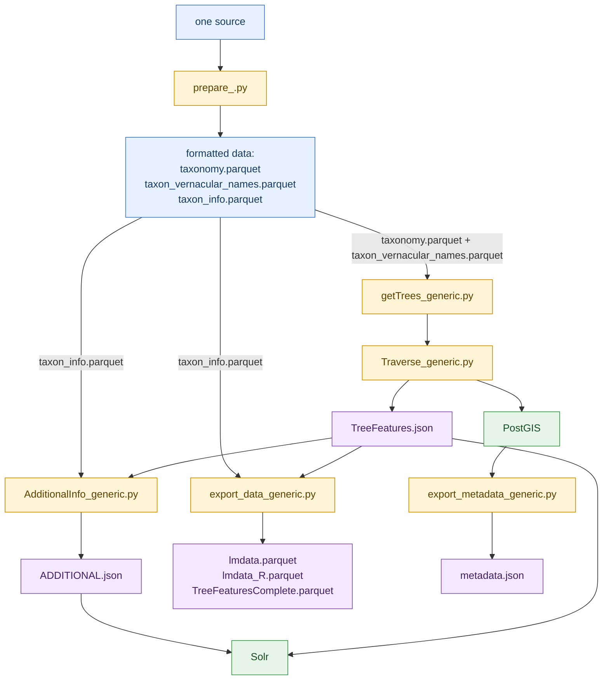

# Multiple taxonomy sources

The new workflow separates taxonomy preparation from tree visualisation:

```text
source data
    ↓
source parser
    ↓
formatted Parquet files
    ↓
Parquet tree builder
    ↓
LifeMap/PostGIS and Solr files
```

Each source is converted into:

```text
taxonomy.parquet
taxon_vernacular_names.parquet
taxon_info.parquet
```

The files are stored under:

```text
data/taxonomy_datasets/<source>/
├── downloads/
└── formatted_data/
```

The current source parsers are:

```text
builder/taxonomy_sources/prepare_ncbi.py
builder/taxonomy_sources/prepare_col.py
builder/taxonomy_sources/prepare_gbif.py
builder/taxonomy_sources/prepare_itis.py
builder/taxonomy_sources/prepare_ott.py
builder/taxonomy_sources/prepare_worms.py
```

The Parquet-based tree workflow writes its build results to:

```text
BUILD_DIRECTORY/<source>/
├── TreeFeatures.json
├── ADDITIONAL.json
├── TreeFeaturesComplete.parquet
├── lmdata_R.parquet
├── lmdata.parquet
├── timestamp.txt
└── metadata.json
```

For an NCBI test:

```bash
cd builder
.venv/bin/python tree/Main_generic.py \
  --source ncbi \
  --roots 2157 2759 2 \
  --disable-progress
```

## New generic tree files

```text
builder/tree/Main_generic.py
builder/tree/getTrees_generic.py
builder/tree/Traverse_generic.py
builder/tree/AdditionalInfo_generic.py
builder/tree/export_data_generic.py
builder/tree/export_metadata_generic.py
```

`getTrees_generic.py` builds the LifeMap tree from formatted Parquet files.
`Traverse_generic.py` keeps the existing geometry code but receives the root
IDs explicitly and writes one `TreeFeatures.json`. Ascend data is prepared by
the source parser and is not recomputed during traversal.

`AdditionalInfo_generic.py` writes one `ADDITIONAL.json` from
`taxon_info.parquet`. The columns in the file depend on the source.

The new Solr upload script is:

```text
builder/update_solr_generic.sh
```

It is called with the source name:

```bash
./builder/update_solr_generic.sh ncbi
```

The complete source-specific update script is:

```text
builder/update_lifemap_generic.sh
```

The source and at least one root must be provided. A single-root test can be run
with:

```bash
./update_lifemap_generic.sh ncbi 2157
```

The existing NCBI workflow remains available through `Main.py` and
`update_solr.sh`.

## Before and after

The important change is that the old workflow both retrieved NCBI data and
built the LifeMap tree. The new workflow first creates a source-independent
formatted dataset. The tree builder only reads that formatted dataset.

In the diagrams, blue means input data, yellow means processing, green means
database, and purple means generated output files.

### Before: NCBI-specific workflow



In this workflow, NCBI-specific reading, tree construction, additional-info
creation, and export are mixed together. The three biological roots are also
part of the old code's assumptions.

### Now: one source through the generic workflow



The core tree-building sequence is almost the same. The main difference is
that source-specific conversion happens before the tree-building functions,
producing the formatted Parquet files. The rest of the build is then reusable
for NCBI, ITIS, OTT, GBIF, CoL, or another source.

`Main_generic.py` is the orchestrator that calls these steps. `db.py` prepares
and finalises the PostGIS tables, but neither is shown as a data-processing
step in the diagram.

The boundary between the two parts is the formatted Parquet data:

```text
source-specific data and downloads
                │
                ▼
      prepare_<source>.py
                │
                ▼
       formatted Parquet files
                │
                ▼
       Main_generic.py and tree code
                │
                ▼
     LifeMap files, PostGIS, and Solr
```

The main differences are:

| Concern | Before | Now |
|---|---|---|
| Source data | NCBI files read by the build process | A parser prepares Parquet first |
| Tree input | NCBI `*.dmp` files and database updates | `taxonomy.parquet` |
| Names | Read as part of the NCBI workflow | `taxon_vernacular_names.parquet` |
| Additional information | Built during the old additional-info step | Read from `taxon_info.parquet` |
| Roots | Assumptions for Archaea, Eukaryota, and Bacteria | Supplied with `--roots` |
| Tree output | Three tree feature files | One `TreeFeatures.json` per source build |
| Additional output | Three additional-info files | One `ADDITIONAL.json` per source build |
| Build results | Shared build directory layout | `BUILD_DIRECTORY/<source>/` |
| Solr upload | Old script uploads the old files | Generic script uploads the source's two files |
| Frontend contract | LifeMap's existing fields | Kept unchanged |

One naming conversion is intentional. Formatted Parquet uses `taxon_id`,
while LifeMap/PostGIS/Solr use the existing LifeMap field name `taxid`.
The generic code performs this conversion at the boundary so that the
frontend and Solr do not need to change.

The old workflow is still present. The generic workflow is a parallel path,
so it can be tested source by source without changing the current production
workflow.

## Other changes

The shared rank table was extended with ranks found in ITIS:

```text
builder/taxo/ranks.csv
```

`check_ranks.py` remains shared by both workflows and now describes its input
as generic taxonomy data rather than NCBI data.
